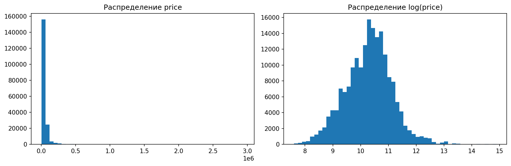
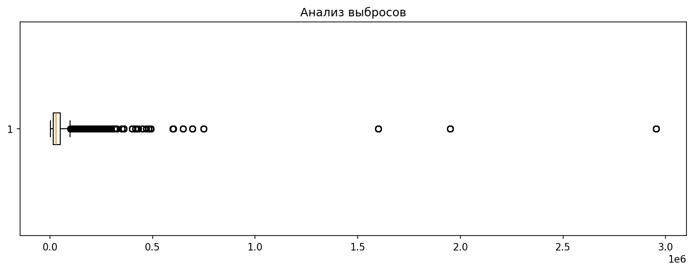
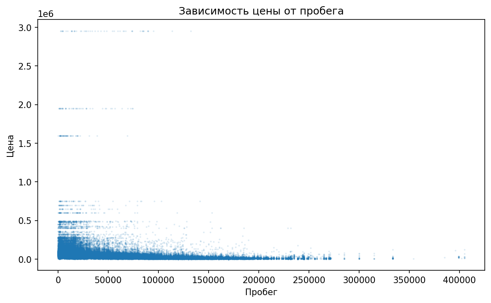
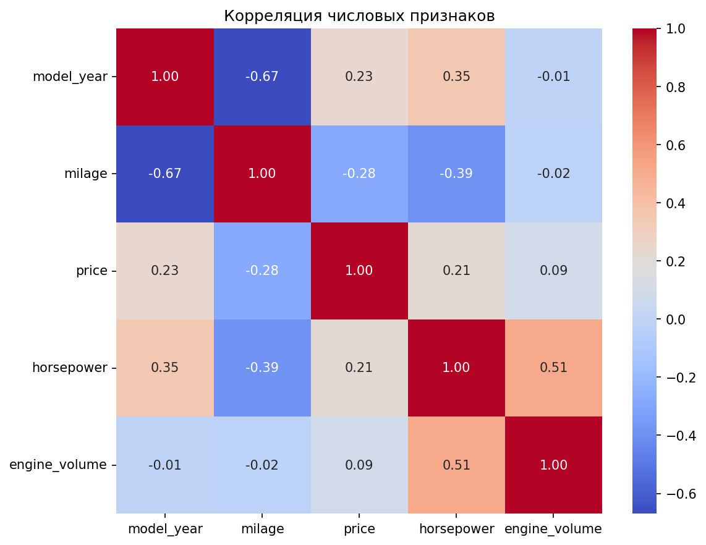
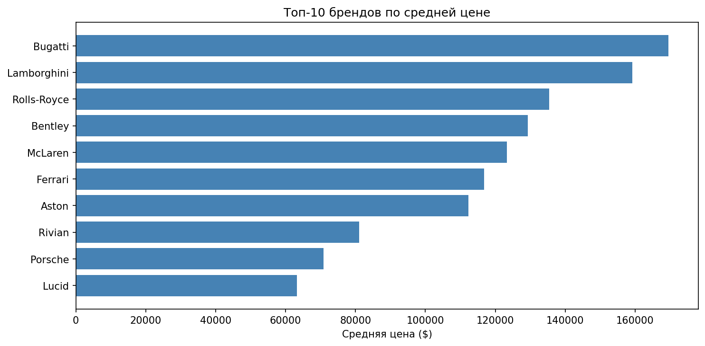
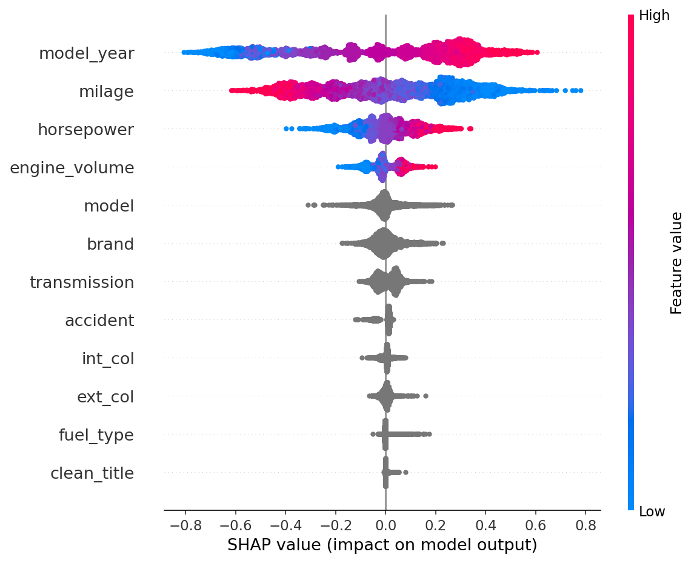
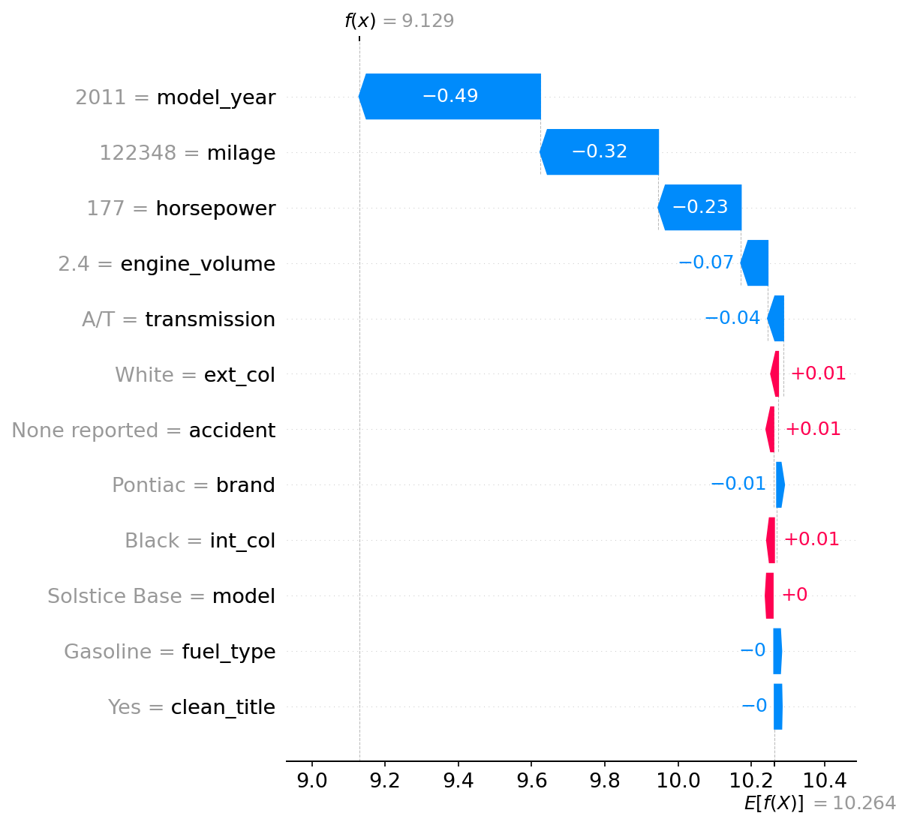

# Used Car Price Prediction

Предсказание цены подержанного автомобиля (Used Cars, 188k строк). Сравнение baseline и Optuna (5 моделей), интерпретация SHAP. Лучшая модель: XGBoost, R2 0.663 на test.

## Данные

Датасет: Used Cars (188 000 строк, 12 признаков). Target — `price`. После фильтрации выбросов (99-й перцентиль на train) и логарифмирования: train 130 665, val 28 280, test 28 280.

## EDA







1. **Цена скошена вправо** (средняя $43 878, макс $2.9 млн). Логарифмирование + обрезка 99-го перцентиля.
2. **Пробег vs цена:** чем больше пробег, тем ниже цена (но разброс большой, зависимость нелинейная).
3. **Корреляции слабые:** макс. 0.28 (`milage` ↔ `price`). Линейная модель не справится.
4. **Бренд — сильнейший предиктор:** Bugatti ($170k), Lamborghini ($160k) в 4 раза дороже среднего.
## Baseline vs Optuna

| Модель | Baseline R2 | Optuna R2 | Delta |
|---|---|---|---|
| Linear Regression | 0.5950 | 0.5950 | -0.0000 |
| Random Forest | 0.6387 | 0.6538 | +0.0151 |
| LGBM | 0.6557 | 0.6592 | +0.0034 |
| XGB | 0.6387 | 0.6626 | +0.0239 |
| CatBoost | 0.6598 | 0.6606 | +0.0008 |


**Вывод:** Optuna дала наибольший прирост для XGB (+0.024 R2) и Random Forest (+0.015). Линейная регрессия не улучшилась — нелинейные зависимости.

## Финальная оценка (test)

| Модель | R2 | MAE ($) | RMSE ($) |
|---|---|---|---|
| Linear Regression | 0.5950 | 18103 | 68239 |
| Random Forest | 0.6538 | 16898 | 66852 |
| LGBM | 0.6592 | 16771 | 66744 |
| XGB | 0.6626 | 16705 | 66647 |
| CatBoost | 0.6606 | 16765 | 66675 |


## Интерпретация (SHAP)




- **Summary:** главные драйверы — `model_year` (новее → дороже) и `milage` (больше пробег → дешевле).
- **Waterfall (один автомобиль):** 2011, 122k миль, Pontiac. Модель снижает цену из-за возраста (−0.49) и пробега (−0.32), отсутствие аварий (+0.01) чуть повышает.

## Ограничения

- R2 0.66 — потолок для этих данных (цена зависит от состояния, истории, комплектации, которых нет).
- Обрезка 99-го перцентиля теряет 1% дорогих машин.
- Категория `model` (тысячи значений) упрощена через OrdinalEncoder для линейки/RF.

## Как запустить

```bash
git clone https://github.com/MaksimPryakhin/used-car-price-regression.git
cd used-car-price-regression
pip install -r requirements.txt
jupyter notebook notebooks/used-cars.ipynb
